<picture><source media="(prefers-color-scheme: dark)" srcset="assets/hero-dark.svg"></picture>

<picture><source media="(prefers-color-scheme: dark)" srcset="assets/stack-dark.svg"></picture>

<picture><source media="(prefers-color-scheme: dark)" srcset="assets/about-dark.svg"></picture>

<a href="https://github.com/CapybaraGalaxy/HOMESCREEN"><picture><source media="(prefers-color-scheme: dark)" srcset="assets/project-homescreen-dark.svg"></picture></a>&nbsp;<a href="https://github.com/CapybaraGalaxy/GP-Learn"><picture><source media="(prefers-color-scheme: dark)" srcset="assets/project-gp-learn-dark.svg"></picture></a>

<a href="https://github.com/CapybaraGalaxy/LOCAL-LEARN"><picture><source media="(prefers-color-scheme: dark)" srcset="assets/project-local-learn-dark.svg"></picture></a>

<picture><source media="(prefers-color-scheme: dark)" srcset="assets/stats-dark.svg"></picture>

<picture><source media="(prefers-color-scheme: dark)" srcset="assets/streak-dark.svg"></picture>

<picture><source media="(prefers-color-scheme: dark)" srcset="assets/wave-dark.svg"></picture>

<a href="https://capybaragalaxy.github.io/HOMESCREEN/"><picture><source media="(prefers-color-scheme: dark)" srcset="assets/button-1-dark.svg"></picture></a>&nbsp;&nbsp;<a href="https://github.com/CapybaraGalaxy?tab=repositories"><picture><source media="(prefers-color-scheme: dark)" srcset="assets/button-2-dark.svg"></picture></a>

<a href="https://metawka.github.io/expressive-profile/?from=CapybaraGalaxy"><picture><source media="(prefers-color-scheme: dark)" srcset="assets/credit-dark.svg"></picture></a>

